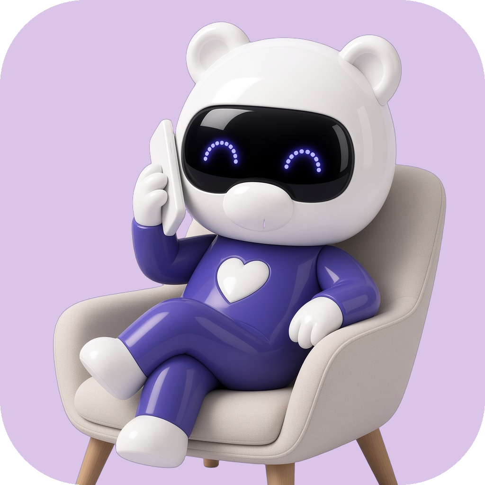

<h1 align="center">Steve</h1>

<p align="center">
  <em>L'agent santé qui agit pour vous.</em>
</p>

<p align="center">
  
</p>

<p align="center">Steve oriente et organise le parcours de soins. Il appelle, réserve et modifie pour vous.</p>

Construit pour l'[Alan x Qovery x AWS : AI Health Hack 2](https://luma.com/o1eopuwy), Paris, 28 novembre 2026.

## Lancer

```bash
pnpm install
pnpm verify
```

Les règles des agents sont dans [AGENTS.md](./AGENTS.md).

## Licence

[Apache-2.0](LICENSE). Copyright 2026 Steve.

### Tiers

Apache-2.0 couvre uniquement le code et les assets propres à Steve.

La [SIL Open Font License 1.1](app/src/fonts/OFL.txt) couvre la police Alan Sans.

La marmotte Alan dans `shared/assets/mascot/duo/` appartient à Alan. Apache-2.0 ne la couvre pas.
