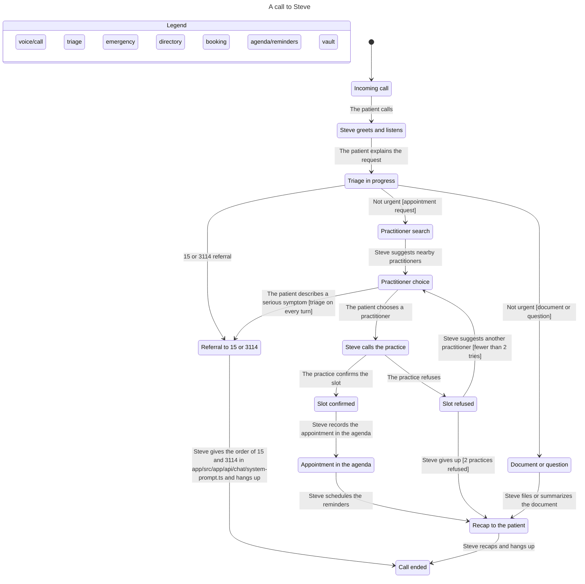

# Features

Ten features. The detail is in each README. The common contracts are in the [shared README](../shared/README.md).

- [voice](voice/README.md) holds the in-app live-call primitives over xAI Realtime and decides nothing. The live call in the app is planned. Twilio comes later.
- [conversation](conversation/README.md) runs the conversation, by voice or by text, then hands off.
- [triage](triage/README.md) classifies each turn as emergency, consult, self-care, or need-info.
- [directory](directory/README.md) finds practitioners in the public Annuaire Santé, and does not book.
- [booking](booking/README.md) calls the chosen practice and returns a confirmed or refused slot.
- [agenda](agenda/README.md) records only confirmed appointments.
- [profile](profile/README.md) stores patient memory, without interpreting it.
- [vault](vault/README.md) stores, retrieves, and summarizes documents, with no medical interpretation.
- [reminders](reminders/README.md) sends a reminder for an appointment or a medication, only for an appointment in the agenda.
- [inbox](inbox/README.md) receives confirmations and reports, files them, and sends documents to practitioners.

## Rules

- Never diagnose.
- The patient-facing 15 and 3114 wording stays in `app/src/app/api/chat/system-prompt.ts`. Triage carries the numbers as call data. Steve does not route to 112 or SOS Médecins.
- `app/src/app/api/chat/route.test.ts` rejects `When in doubt, call 15.` and `call 116 117`. The same file checks the system prompt and each triage guidance string with one matcher. The matcher applies NFC, strips accents, turns Unicode spaces into a space, turns apostrophes into `'`, and lowercases. It then flags `ne`, `n'`, `pas`, `jamais`, `sans`, or a word starting with `evit` within 32 characters of `15`, `3114`, or `samu`. It also flags `ne pas appeler`. Approved sentences in the system prompt are allowlisted. The live prompt passes. Both guidance strings pass. An injected variant fails.
- Steve does not book a 15 or 3114 referral.
- Nothing enters the agenda without confirmation from the practice.
- Reminders cover only appointments that are in the agenda.
- Every conversation ends with the patient informed.

## Statechart

The `voice/call` legend color now covers `voice` and `conversation`.

