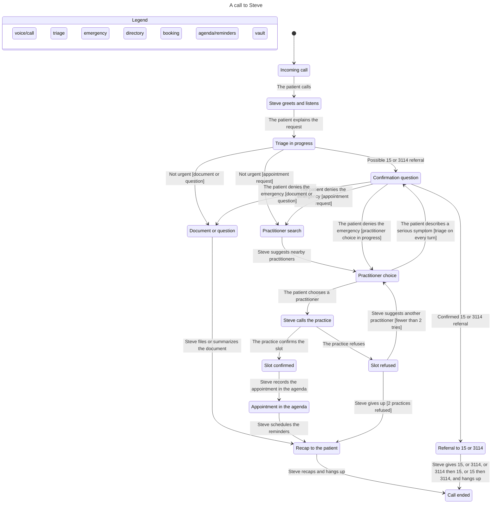

# Features

Ten features. The detail is in each README. The common contracts are in the [shared README](../shared/README.md).

- [voice](voice/README.md) connects Twilio to the voice provider, carries the audio, and decides nothing.
- [conversation](conversation/README.md) runs the conversation, by voice or by text, then hands off.
- [triage](triage/README.md) classifies each turn and orients toward a practitioner type and a delay.
- [directory](directory/README.md) finds practitioners in the public Annuaire Santé, and does not book.
- [booking](booking/README.md) calls the chosen practice and returns a confirmed or refused slot.
- [agenda](agenda/README.md) records only confirmed appointments.
- [profile](profile/README.md) stores patient memory, without interpreting it.
- [vault](vault/README.md) stores, retrieves, and summarizes documents, with no medical interpretation.
- [reminders](reminders/README.md) sends a reminder for an appointment or a medication, only for an appointment in the agenda.
- [inbox](inbox/README.md) receives confirmations and reports, files them, and sends documents to practitioners.

## Rules

- Never diagnose.
- 15 is only for a real emergency.
- A real emergency is physical warning signs, an overdose, self-harm, or immediate danger.
- For an ordinary symptom, Steve names 15 only beside physical warning signs.
- Doubt does not default to 15.
- 3114 is for psychological distress and for suicidal thoughts.
- An overdose or self-harm that includes suicidal thoughts or psychological distress starts with 3114 and then adds 15.
- For suicidal thoughts or psychological distress, with no overdose, no self-harm and no physical warning sign, Steve gives 3114 first and adds 15 only for immediate danger.
- With no overdose and no self-harm, Steve gives 15 first, then 3114, when a physical warning sign comes with suicidal thoughts or psychological distress. Chest pain during a panic attack is an example.
- Steve never gives 112 or SOS Médecins.
- The wording is `app/src/app/api/chat/system-prompt.ts`.
- `app/src/app/api/chat/route.test.ts` rejects only the literals `Dans le doute, appelle le 15.` and `appelle le 116 117`.
- Steve does not book a 15 or 3114 referral.
- Nothing enters the agenda without confirmation from the practice.
- Reminders cover only appointments that are in the agenda.
- Every conversation ends with the patient informed.

## Statechart

The `voice/call` legend color now covers `voice` and `conversation`.

