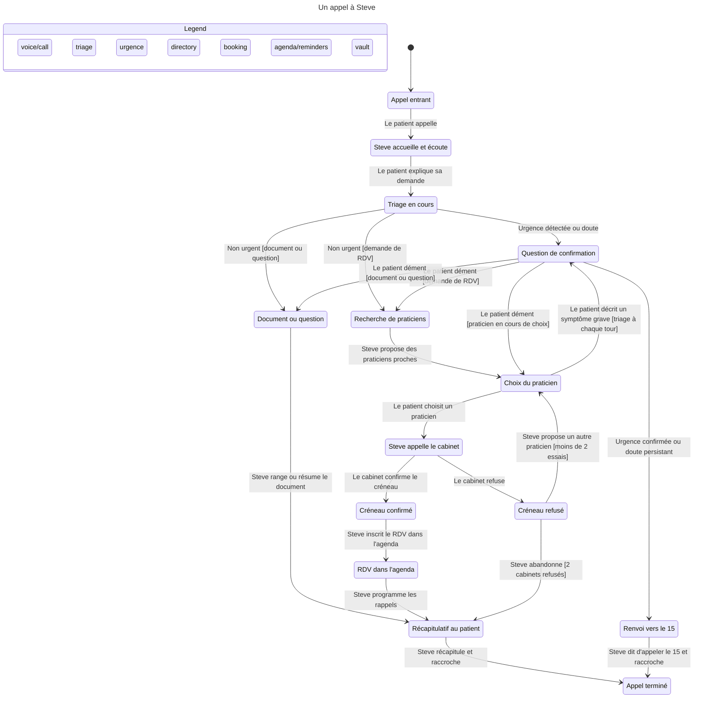

# Features

Dix features. Le détail est dans chaque README. Les contrats communs sont dans le [README de shared](../shared/README.md).

- [voice](voice/README.md) relie Twilio au fournisseur vocal, transporte l'audio, et ne décide rien.
- [conversation](conversation/README.md) orchestre la conversation, en voix ou en texte, puis passe la main.
- [triage](triage/README.md) classe chaque tour et oriente vers un type de praticien et un délai.
- [directory](directory/README.md) trouve des praticiens dans l'Annuaire Santé public, et ne réserve pas.
- [booking](booking/README.md) appelle le cabinet choisi et rapporte un créneau confirmé ou refusé.
- [agenda](agenda/README.md) enregistre seulement les rendez-vous confirmés.
- [profile](profile/README.md) garde la mémoire du patient, sans l'interpréter.
- [vault](vault/README.md) stocke, retrouve et résume des documents, sans interprétation médicale.
- [reminders](reminders/README.md) rappelle un rendez-vous ou un médicament, seulement pour un rendez-vous de l'agenda.
- [inbox](inbox/README.md) reçoit les confirmations et les comptes rendus, les classe, et envoie des documents aux praticiens.

## Règles

- Ne jamais diagnostiquer.
- Une urgence confirmée part vers le 15, sans réservation.
- Rien n'entre dans l'agenda sans confirmation du cabinet.
- Les rappels ne portent que sur les rendez-vous qui sont dans l'agenda.
- Chaque conversation se termine avec le patient informé.

## Statechart

La couleur `voice/call` de la légende couvre maintenant `voice` et `conversation`.

